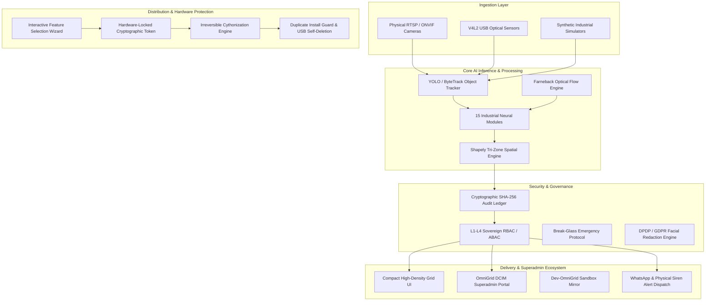

# VisionXR • Sector 22 Sovereign AI Surveillance & Threat Matrix

**Deployment Path**: `/var/www22/visionXR`  
**Sovereign Sector IP**: `127.0.0.22:80` / `https://visionxr.adamconsult.com`  
**Direct Backend Core**: `http://127.0.0.22:8022/` or `http://localhost:8022/`  
**Omnigrid DCIM Alignment**: Sector 22 under Sovereign Superadmin Governance  
**Emergency Escalation**: WhatsApp Desk (`+91-8779639965`), Sovereign Control Siren, Omnigrid NOC Sentinel  

---

## 1. System Overview & Architecture

VisionXR operates as the high-throughput, edge-native computer vision and physical security intelligence engine for the **OmniGrid Sovereign Infrastructure Ecosystem** (Sector 22). It unifies multi-format IP/CCTV camera ingestion, optical flow analytics, 15 specialized industrial AI neural inference modules, cryptographically sealed tamper-evident forensic ledgers, and zero-trust Superadmin controls.



---

## 2. 15 Industrial Computer Vision & Surveillance Engines

VisionXR includes 15 distinct, production-grade visual analytics pipelines built for mission-critical industrial manufacturing, data centers, oil & gas switchyards, airports, and high-security campuses:

| # | Industrial Module | Engine & Detection Logic | Operational Impact |
|---|---|---|---|
| **01** | **High-Speed Traffic ANPR / ALPR** | Optical character recognition (PaddleOCR / Tesseract / regex) with Indian (HSRP) & international plate syntax validation. | Automated gate control, vehicle logging, and hotlist/stolen vehicle interception. |
| **02** | **FRSS Facial Recognition & Biometrics** | 128-d deep facial embedding cosine similarity against encrypted personnel directory. | Seamless turnstile bio-entry, VIP identification, and blacklisted intruder alerts. |
| **03** | **Directional IN/OUT Tripwire Counting** | Bidirectional vector crossing across configurable spatial 2D lines with hysteresis suppression. | Precise occupancy auditing, room capacity limits, and emergency muster roll tracking. |
| **04** | **Tri-Zone Spatial Loitering & Intrusion** | Mathematical polygon containment (`Shapely`) for 🟢 Green (Safe), 🟡 Amber (Caution), and 🔴 Red (Restricted) zones with dwell-time accumulators. | Immediate perimeter breach alerts and unauthorized personnel escalation. |
| **05** | **Crowd Density & Clustering Heatmaps** | Spatial point clustering with density heatmaps and optical flow velocity dispersion. | Stampede early warning, bottleneck detection, and shopfloor congestion mitigation. |
| **06** | **Deep Visual Attribute Search** | Multi-attribute feature extraction: clothing color (upper/lower), helmet presence, backpack, gender, and vehicle color/type. | Post-incident forensic queries (e.g. "Find person with red shirt near Substation at 14:20"). |
| **07** | **Fence Vaulting & Perimeter Breach** | Aspect ratio transformation with upward vertical velocity vector tracking near boundary bounding boxes. | Eliminates false alarms from wind/branches while catching active wall/fence climbers. |
| **08** | **Unattended Baggage & Debris Dumping** | Stationary bounding-box timer with background subtraction and owner-proximity detachment detection. | Anti-terror baggage alerts, fly-tipping / illegal hazardous debris dumping detection. |
| **09** | **Early Warning Fire & Smoke Sentinel** | Dual-spectrum HSV color classification (fire flickers) combined with low-frequency spatial smoke expansion models. | Instant factory floor fire warning seconds before smoke detector ionization triggers. |
| **10** | **Automated PPE Safety Compliance** | Hardhat, high-visibility reflective vest, and safety goggles color segmentation in HSV/RGB space with compliance scoring. | Enforces OSHA/ISO 45001 safety mandates and logs non-compliant contractors. |
| **11** | **Vehicle Speed & Wrong-Way Tracking** | Pixel-to-meter homography calibration with vector trajectory orientation against designated road flow. | Enforces 15 km/h internal campus speed limits and flags wrong-way driving in one-way lanes. |
| **12** | **Multi-Camera Object Re-Identification** | Deep feature vector matching across non-overlapping camera FOVs to track targets across physical campus. | Continuous tracking of suspects or high-value VIPs across disparate facility sectors. |
| **13** | **Optical Tamper & Lens Occlusion Sentinel** | Image entropy, blur variance (Laplacian), and sudden structural SSIM loss detection. | Detects camera spray-painting, lens bagging, physical misdirection, and defocusing. |
| **14** | **Violence, Falls & Aggressive Gestures** | Sudden vertical drop velocity ("Man-Down" motionless $>15$s) and rapid limb acceleration optical flow. | Immediate medical rescue dispatch and control-room alert on physical altercations. |
| **15** | **Cryptographic Forensic Snapshot Export** | High-resolution raw frame capture with watermark overlay, SHA-256 integrity digest, and tamper-proof audit trail. | Court-admissible evidence packages with verifiable chain of custody. |

---

## 3. Compact High-Density Operator UI

The control room interface has been re-architected for maximum camera viewport area and zero distraction:

* **Dual Instant Collapsible Sidebars**:
  * `◀ CHANNELS` toggles the left channel selector between expanded view and fully hidden stage.
  * `EVENTS ▶` toggles the right telemetry & incident rail for unobstructed full-screen monitoring.
  * Driven by direct DOM inline style mutation (`display: none` / `gridTemplateColumns`), guaranteeing instant collapse/expand regardless of browser CSS caching.
* **Ultra-Compact Channel Pills**:
  * 26px channel buttons in the left rail with pulsating green live status dots and real-time FPS telemetry.
  * Compact 2x2 disaster radar pills.
* **Minimalist Video Feeds**:
  * Large, distracting legacy `SOURCE` and `RETIRE` buttons replaced by sleek 20px translucent micro-pills:
    * `[🔍]` **Solo Toggle**: Instantly toggles the camera into an isolated 1x1 full-viewport inspection mode and back to 2x2 grid.
    * `[⚙]` **Config**: Opens channel parameters, RTSP source, and resolution tuning.
    * `[📸]` **Snapshot**: Captures high-res forensic snapshot with timestamp, SHA-256 digest, and watermark.
    * `[✕]` **Retire**: Gracefully retires the channel and frees system resources.
  * Non-stretching 2x2 grid layout enforcing clean aspect ratio without 5th-cell stretching.
* **Compact Telemetry Pills**:
  * Right sidebar telemetry metrics rendered in sleek 24px pills matching top navigation controls.

---

## 4. Hardened USB Client Distribution Builder

The production client package builder (`scripts/build_distribution_usb.py`) compiles tailor-made, zero-leakage, irreversible deployment packages for industrial clients:

### Core Security & Hardening Controls

1. **Interactive Feature Selection Wizard**:
   * During build time, administrators select only the specific industrial modules required by the client (e.g. ANPR only, Safety PPE only, or Full Enterprise Suite).
   * Unselected modules and unused UI views are omitted from the target payload.
2. **Strict Developer-Only Button Purge**:
   * The `🔑 LICENSE` button/modal and `💾 USB EXPORT` builder controls are **strictly developer-only tools**.
   * The distribution builder automatically purges all HTML markup, JavaScript event handlers, CSS classes, and backend API routes relating to `LICENSE` and `USB EXPORT` from client builds.
3. **100% Zero Developer Static Data**:
   * Feeds, camera definitions, custom zones, and development logs are strictly sanitized.
   * `cameras.json` = `[]`
   * `zones.json` = `[]`
   * `attribute_ledger.json` = `[]`
   * Client machines boot with clean data stores ready for first-time site provisioning.
4. **Single-Hardware Cryptographic Lockdown**:
   * Upon installation, the software generates a unique hardware signature combining `/etc/machine-id`, CPU model, MAC address, and primary root disk UUID.
   * The application is sealed to that hardware token. Copying the folder to another machine causes startup termination.
5. **Duplicate Installation Guard**:
   * The installer checks the target machine's system state (`/var/run/visionxr.lock`, systemd unit registry, existing binary footprints).
   * If a previous or conflicting installation is detected, execution aborts to prevent corruption.
6. **Irreversible Cythonization**:
   * All Python modules are compiled directly into native C-extensions (`.so` shared libraries on Linux, `.pyd` on Windows).
   * Original human-readable `.py` source files are wiped and unrecoverable from the client bundle.
7. **USB Self-Deletion Sentinel**:
   * Once installation and hardware-binding complete successfully on the client machine, the installer automatically executes a self-deletion routine that wipes the installation binary payload from the source USB drive.
8. **Developer Mother Server Exemption**:
   * All hardening, single-machine binding, Cythonization, and self-deletion rules **strictly do NOT apply** to the Developer Mother Server (`/var/www22/visionXR`) and Dev Omnigrid (`/var/www8/dev-omnigrid`). They remain fully open, uncompiled, and uninhibited.

---

## 5. OmniGrid & Dev-OmniGrid DCIM Integration

VisionXR is fully integrated under OmniGrid's Sovereign Superadmin Governance:

* **Sector Identity**: `Sector 22: VisionXR AI Surveillance & Threat Matrix`.
* **Superadmin Header Control**: Direct 1-click `VISIONXR` control pill with pulsating indicator in OmniGrid's primary navigation header (`templates/admin/base_site.html`).
* **CommandCenter Tile**: Real-time `22.00 VISIONXR AI NEURAL MATRIX` hero card on the main dashboard (`templates/admin/command_center.html`), reporting live module health, camera counts, threat neutralizations, and portal access.
* **Superadmin Security Wall**: Access is restricted to `is_superuser`, `superadmin` role, or cryptographic IP whitelists. Non-superadmin users are restricted with zero role leakage.
* **Dev-OmniGrid Mirroring**: Full 1:1 symmetry between Production OmniGrid (`/var/www/omnigrid`) and Development OmniGrid (`/var/www8/dev-omnigrid`).

---

## 6. Operational Controls & Commands

### Start VisionXR Engine
```bash
/var/www22/visionXR/scripts/start_visionxr.sh
```

### Stop VisionXR Engine
```bash
/var/www22/visionXR/scripts/stop_visionxr.sh
```

### Build Client Distribution Package to USB
```bash
python3 /var/www22/visionXR/scripts/build_distribution_usb.py --usb /media/adity/Sony-Media --client "Industrial-Client-Alpha"
```

### Verify Service Health & Cryptographic Ledger
```bash
curl -s http://127.0.0.1:8022/api/health
curl -s http://127.0.0.22:8022/api/security/audit/verify
```
